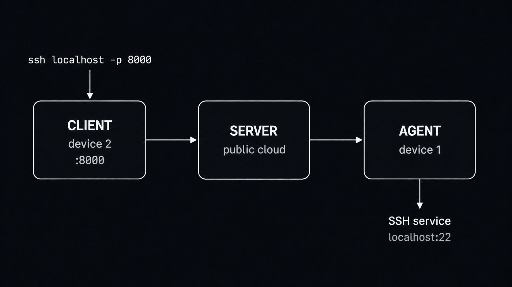

<div align="center">

# node-tunnel

**Reach private TCP services through your own public relay.**

[](https://github.com/mgrybyk/node-tunnel/actions/workflows/ci.yml)
[](https://nodejs.org/)
[](LICENSE)
[](package.json)

</div>

`node-tunnel` is a small, self-hosted reverse TCP tunnel. Run a relay on a
public host, an agent beside the private service, and a client wherever you
want to use it. SSH, RDP, databases, HTTP, and other TCP protocols all work
through the same three-process setup.

- **Self-hosted** — the relay runs on infrastructure you control.
- **NAT-friendly** — the agent and client connect out to the public relay.
- **Dependency-free at runtime** — built entirely on Node.js core modules.
- **Resilient** — reconnect backoff, TCP keepalive, and graceful shutdown are
  built in.

## How it works

The client on device 1 and the agent on device 2 both connect outward to the
public relay. The client exposes `127.0.0.1:8000`, which is routed through the
relay to `localhost:22` on device 2.



## Quick start tunnel SSH

You need Node.js 24 or newer on all three hosts. Clone and install the project
on each one:

```sh
git clone https://github.com/mgrybyk/node-tunnel.git
cd node-tunnel
npm ci
```

Generate a private 32-character key once, then use the result in every config:

```sh
openssl rand -hex 16
```

### 1. Start the relay

Create `relay.env` on the public host:

```dotenv
N_T_CRYPT_KEY=<same-32-character-key>
N_T_RELAY_BIND_HOST=0.0.0.0 # change to 127.0.0.1 if the relay is behind a proxy
N_T_RELAY_PORT=32121
```

Allow inbound TCP traffic to the relay port (`32121`), then start the relay:

```sh
npm run relay -- relay.env
```

### 2. Start the agent on device 2

Create `agent.env` beside the private SSH service:

```dotenv
N_T_CRYPT_KEY=<same-32-character-key>
N_T_RELAY_HOST=relay.example.com
N_T_RELAY_PORT=32121

N_T_AGENT_NAME=my-ssh
N_T_AGENT_DATA_HOST=127.0.0.1
N_T_AGENT_DATA_PORT=22
```

```sh
npm run agent -- agent.env
```

The target can also be another host reachable from device 2; set
`N_T_AGENT_DATA_HOST` accordingly.

### 3. Start the client on device 1

Create `client.env` where you want the local SSH entry point:

```dotenv
N_T_CRYPT_KEY=<same-32-character-key>
N_T_RELAY_HOST=relay.example.com
N_T_RELAY_PORT=32121

N_T_CLIENT_NAME=my-ssh
N_T_CLIENT_BIND_HOST=127.0.0.1 # change to 0.0.0.0 if you want other clients in your network to access the client port
N_T_CLIENT_PORT=8000
```

```sh
npm run client -- client.env
```

The client and agent names must match. Now connect on device 1 to device 2:

```sh
ssh user@127.0.0.1 -p 8000
```

The same pattern works for any TCP service: change the agent target port, the
client's local port, and the route name.

### Using TLS and proxy

Add to all agents and clients:

```dotenv
N_T_USE_TLS=true
```

You have to generate certificates for your domain and use a TLS proxy. For example HAProxy. See HAProxy [haproxy.cfg](docs/haproxy.cfg) example.

## Deployment notes

- Relay, agent, and client must use the same protocol version. Incompatible
  peers log an error and exit.

<details>
<summary><strong>Reliability and lifecycle settings</strong></summary>

```dotenv
N_T_RECONNECT_DELAY_MS=4000
N_T_RECONNECT_MAX_DELAY_MS=30000
N_T_RECONNECT_JITTER_PERCENT=10
N_T_HANDSHAKE_TIMEOUT_MS=3000
N_T_CONTROL_IDLE_TIMEOUT_MS=15000
N_T_HEARTBEAT_INTERVAL_MS=5000
N_T_HEARTBEAT_TIMEOUT_MS=15000
N_T_SHUTDOWN_TIMEOUT_MS=2000
```

Reconnects use capped exponential backoff with jitter.
`N_T_RECONNECT_JITTER_PERCENT` randomizes each retry delay by ± the given
percentage to spread reconnect attempts after an outage. With the default `10`,
a 4-second base delay becomes 3.6–4.4 seconds. Set it to `0` for deterministic
retry timing; most deployments can leave it at the default. The maximum delay
caps the exponential base before jitter is applied.

Established control and
tunnel sockets enable TCP keepalive after 30 seconds of inactivity; the OS
controls later probes. `N_T_HANDSHAKE_TIMEOUT_MS` is a fixed application-level
deadline: control connections must receive relay registration and both tunnel
data connections must receive relay readiness before it expires. Network
traffic does not extend that deadline. On `SIGINT` or `SIGTERM`, processes stop
accepting work, allow active streams a bounded drain period, and then close
remaining sockets.

Registered agents and clients send a ping every `N_T_HEARTBEAT_INTERVAL_MS`.
A missing pong triggers reconnect after `N_T_HEARTBEAT_TIMEOUT_MS` from the
first unanswered ping; other incoming traffic does not extend this deadline.
Set the relay control idle timeout above the heartbeat interval. Active data
streams have no application idle cutoff, since TCP services can legitimately
remain silent.

</details>

### Diagnosing TLS/proxy stalls

Temporarily set these in the agent environment file (and, when possible, on the
client and relay too), then restart the processes:

```dotenv
N_T_LOG_DEBUG=true
N_T_LOG_ERROR=true
```

Debug events use one line each with a timestamp and socket ID. They cover TCP/TLS
setup, registration, readiness, errors, timeouts, reconnects, and tunnel pairing.
Socket close events include the last phase, lifetime, and total byte counts.
There are no periodic snapshots, heartbeat success logs, or per-chunk logs.

A hashed `tunnelRef` identifies the same tunnel across agent, client, and relay
logs without exposing its ticket. Match it against the relay's `data-accepted`,
`waiting-for-peer`, `paired-ready-queued`, and `pending-cancelled` events to see
whether a peer failed to arrive or the ticket expired. The logs contain
connection addresses and TLS certificate issuer information, but socket/tunnel
traces omit application payloads, encryption keys, and raw tickets.

With `N_T_LOG_DEBUG=false`, these diagnostics install no socket listeners or
timers, compute no tunnel hashes, and skip constructing debug fields. Logging
settings are read at startup; restart the process after changing them.

These traces can distinguish timing/backpressure bugs from proxy interruptions;
they do not by themselves establish that Zscaler caused a failure. Control frames
already support fragmentation/coalescing and authenticate their contents, so
smaller messages are not a demonstrated fix. Return both logging settings to
`false` after collecting the reproduction.

If you deployed the sample HAProxy config, also check its connection rejection
logs: it permits 32 simultaneous connections and 32 new connections per 10
seconds per source IP. A shared proxy/NAT egress address can make multiple users
share these limits. Each peer uses a control connection plus a separate data
connection per tunnel. This is a deployment hypothesis to verify against the
actual proxy configuration and logs.

## JavaScript API

Imports have no side effects. Each entry point exposes a lifecycle factory:

```js
const { createRelay } = require('node-tunnel')

const relay = createRelay(options)
await relay.start()
await relay.close()
```

| Entry point          | Export                             |
| -------------------- | ---------------------------------- |
| `node-tunnel`        | `createRelay`                      |
| `node-tunnel/agent`  | `createAgent`                      |
| `node-tunnel/client` | `createClient`                     |
| `node-tunnel/config` | Environment-backed config builders |

## Security

> [!WARNING]
> TLS protects traffic to the public relay, but it is not end-to-end encryption.
> See [Security](docs/SECURITY.md).

This project is still a prototype. Use TLS and appropriate network hardening
when exposing it to untrusted networks.

## Development

See [ARCHITECTURE.md](docs/ARCHITECTURE.md) for module responsibilities, connection
flow, lifecycle ownership, and the transport boundary.

```sh
npm run check
npm test
npm run test:coverage
```

The end-to-end suite starts a real relay, two agents, and six clients. It
exercises 72 binary streams over three traffic waves, with 24 streams active in
parallel per wave and roughly 158 MiB transferred. CI runs checks and coverage
on Ubuntu and Windows.

### Benchmarking

See [BENCHMARK.md](docs/BENCHMARK.md) for the sustained 3-agent/12-client scenario,
outage preset, JSON reports, failure diagnostics, and comparison format.

For a release, also run `npm pack --dry-run`, update `CHANGELOG.md`, and bump
`PROTOCOL_VERSION` only when messages, framing, handshakes, or other wire
semantics become incompatible.
