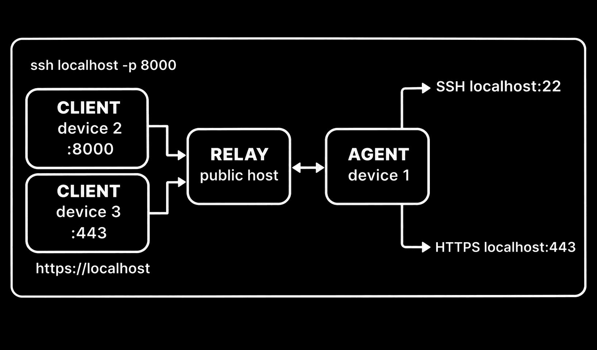

# node-tunnel

foobar

**Reach private TCP services through your own public relay.**

[](https://github.com/mgrybyk/node-tunnel/actions/workflows/ci.yml)
[](https://nodejs.org/)
[](LICENSE)

`node-tunnel` is a small, self-hosted reverse TCP tunnel. It connects local
clients to private services through a relay on a public host. SSH, RDP,
databases, HTTP, and other TCP protocols use the same setup.

## Is it for me?

Use `node-tunnel` when:

- the target service is behind NAT or a firewall;
- you control a publicly reachable host; and
- you want a self-hosted tunnel with no runtime dependencies.

Know that it requires relay, agent, and client processes, supports TCP only,
and currently uses one shared key for all peers. The project is still a
prototype; read the [security limitations](docs/SECURITY.md) before exposing it
to an untrusted network.

## How it works

The agent and clients connect outward to the same public relay. Multiple clients
can access services through one agent, with local ports mapped to agent target
ports using [port lists or ranges](docs/CONFIGURATION.md#port-lists-and-ranges).



## Quick start: tunnel SSH

You need Node.js 24 or newer on all three hosts. Clone the project on each host:

```sh
git clone https://github.com/mgrybyk/node-tunnel.git
cd node-tunnel
```

Role-specific templates are available in [relay.example.env](relay.example.env),
[agent.example.env](agent.example.env), and [client.example.env](client.example.env).
All endpoint addresses, ports, and route IDs must be set explicitly.

Generate one private key and use it in all three configuration files:

```sh
openssl rand -hex 16
```

### 1. Public host: relay

Create `relay.env`:

```dotenv
N_T_CRYPT_KEY=<same-32-character-key>
N_T_RELAY_BIND_HOST=0.0.0.0
N_T_RELAY_PORT=32121
```

Allow inbound TCP traffic on port `32121`, then run:

```sh
node relay relay.env
```

### 2. Private host: agent

Create `agent.env` beside the SSH service:

```dotenv
N_T_CRYPT_KEY=<same-32-character-key>
N_T_RELAY_HOST=relay.example.com
N_T_RELAY_PORT=32121

N_T_ROUTE_ID=my-ssh
N_T_AGENT_DATA_HOST=127.0.0.1
N_T_AGENT_DATA_PORTS=22
```

```sh
node agent agent.env
```

The target can be any host reachable by the agent, not only the agent host.

### 3. Local host: client

Create `client.env`:

```dotenv
N_T_CRYPT_KEY=<same-32-character-key>
N_T_RELAY_HOST=relay.example.com
N_T_RELAY_PORT=32121

N_T_ROUTE_ID=my-ssh
N_T_CLIENT_BIND_HOST=127.0.0.1
N_T_CLIENT_PORTS=8000
```

```sh
node client client.env
```

The client and agent must use the same `N_T_ROUTE_ID`. Connect through the local port:

```sh
ssh user@127.0.0.1 -p 8000
```

For another TCP service, change the agent target, client port, and route ID.

## Next steps

- [Configuration](docs/CONFIGURATION.md) — all settings and the JavaScript API
- [Deployment](docs/DEPLOYMENT.md) — TLS, HAProxy, reliability, and diagnostics
- [Security](docs/SECURITY.md) — trust model and current limitations
- [Architecture](docs/ARCHITECTURE.md) — connection flow and implementation
- [Benchmarking](docs/BENCHMARK.md) — load and recovery scenarios

Relay, agent, and client must use the same protocol version. Upgrade them
together.

## Development

```sh
npm ci
npm run check
npm test
npm run test:coverage
```

See [Architecture](docs/ARCHITECTURE.md) before changing connection or lifecycle
behavior. For releases, run `npm pack --dry-run`, update `CHANGELOG.md`, and bump
`PROTOCOL_VERSION` only for incompatible wire changes.
